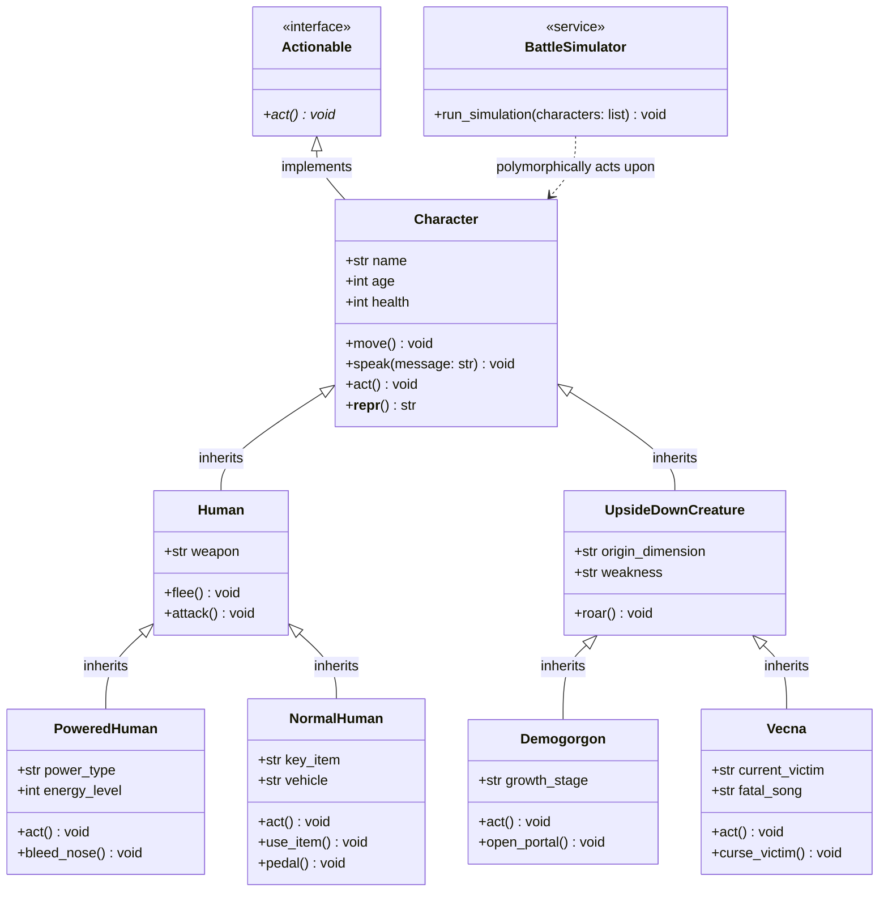

# 🌌 STRANGER THINGS: OOP BATTLE FOR HAWKINS 🚲


<div align="center">

<!-- BANNER DINÁMICO CON TIPOGRAFÍA STRANGER THINGS (SVG ANIMADO) -->


<p align="center">
  
  
  
  
  
  
</p>

```
    .--------------------------------------------------------------------------------.
    |   🔴     🟡     🟢     🔵     🟣     🔴     🟡     🟢     🔵     🟣     🔴     |
    |    R      U      N    . . .    T H E    G A T E    I S    O P E N !            |
    '--------------------------------------------------------------------------------'
```

> *"Amigos no mienten... y el buen código orientado a objetos tampoco."* — **Hawkins Party Code of Honor**

---

### 👤 FICHA DE LA AUTORA & INVESTIGADORA PRINCIPAL

<table align="center" style="border: 2px solid #ff0044; border-radius: 12px; background-color: #0b0c10;">
  <tr>
    <td align="center" width="160" style="background: radial-gradient(circle, #2b0b14, #0b0c10);">
      
      <br>
      <b>👾 CHIEF INVESTIGATOR</b>
    </td>
    <td>
      <h3>🔬 Patricia Aparicio Díaz</h3>
      <p><b>🏷️ Rol en Hawkins:</b> <i>Lead OOP Software Architect & Upside Down Defense Lead</i></p>
      <p><b>📻 Canales de Contacto:</b></p>
      <p>
        <a href="https://github.com/apariciodiazpatricia-cell" target="_blank">
          
        </a>
        <a href="mailto:apariciodiazpatricia@gmail.com">
          
        </a>
        
      </p>
      <p><i>Arquitectura orientada a objetos en Python, Contratos Abstractos (ABC), Desarrollo Guiado por Comportamiento (BDD con Gherkin) y Simulación Interactiva.</i></p>
    </td>
  </tr>
</table>

---

</div>

## 📑 TABLA DE CONTENIDOS

1. [📜 Descripción del Proyecto](#-descripción-del-proyecto)
2. [📁 Estructura del Proyecto](#-estructura-del-proyecto)
3. [🧬 Arquitectura y Principios POO](#-arquitectura-y-principios-poo)
4. [👥 Modelado del Elenco de Hawkins y Entidades](#-modelado-del-elenco-de-hawkins-y-entidades)
5. [🥒 Especificaciones BDD con Gherkin (`battle.feature`)](#-especificaciones-bdd-con-gherkin-battlefeature)
6. [🧪 Suite de Pruebas Unitarias Automatizadas (`test_characters.py`)](#-suite-de-pruebas-unitarias-automatizadas-test_characterspy)
7. [🕹️ Hawkins 2D Live Arena (`index.html`)](#-hawkins-2d-live-arena-indexhtml)
8. [🚀 Guía de Instalación y Ejecución](#-guía-de-instalación-y-ejecución)
9. [📼 Canción de Salvación (Anti-Vecna)](#-canción-de-salvación-anti-vecna)

---

## 📜 DESCRIPCIÓN DEL PROYECTO

**Stranger Things OOP** es un sistema de simulación de combate y modelado de dominio ambientado en el universo de *Hawkins, Indiana (1983-1986)*.

El proyecto demuestra las mejores prácticas de la **Programación Orientada a Objetos (POO)** en Python:
* **Abstracción**: Contratos e interfaces abstractas mediante `abc.ABC` (`contracts/actionable.py`).
* **Herencia limpia**: Clases base para seres humanos y criaturas interdimensionales del *Upside Down*.
* **Polimorfismo puro**: El motor de simulación trata a todos los miembros por igual llamando al método `act()`.
* **BDD (Behavior-Driven Development)**: Especificación de casos de combate en lenguaje natural usando **Gherkin** y suite de pruebas unitarias con `unittest`.
* **Arena 2D interactiva**: Interfaz web con animaciones y sintetizador de audio retro basado en la Web Audio API.

---

## 📁 ESTRUCTURA DEL PROYECTO

```text
📦 stranger-things-oop/
├── 📂 characters/                  # 👥 Modelos del elenco de Hawkins y criaturas
│   ├── 📜 __init__.py              # Exportador del módulo de personajes
│   ├── 📜 character.py             # Clase base Character (implementa Actionable)
│   ├── 📜 creature.py              # Criaturas del Upside Down (Demogorgon, Vecna)
│   └── 📜 human.py                 # Entidades humanas (PoweredHuman, NormalHuman)
├── 📂 contracts/                   # 📜 Contratos de diseño e interfaces abstractas
│   ├── 📜 __init__.py              # Exportador de contratos
│   └── 📜 actionable.py            # Interfaz Actionable (@abstractmethod act)
├── 📂 services/                    # ⚔️ Orquestación y lógica de combate
│   ├── 📜 __init__.py              # Exportador de servicios
│   └── 📜 battle_simulator.py      # Motor polimórfico BattleSimulator
├── 📂 tests/                       # 🧪 BDD y Aseguramiento de Calidad
│   ├── 📜 __init__.py              # Módulo de tests
│   ├── 📜 battle.feature           # 🥒 Escenarios Gherkin en lenguaje natural
│   └── 📜 test_characters.py       # ⚡ Suite unittest con 6/6 tests pasando
├── 📜 index.html                   # 🕹️ Hawkins 2D Live Arena (GUI Web con Web Audio API)
├── 📜 main.py                      # 🚀 Punto de entrada principal en consola
└── 📜 README.md                    # 📖 Documentación oficial del proyecto
```

### 🔍 Detalle de Módulos y Responsabilidades

| Archivo | Responsabilidad | Lore de Hawkins |
| :--- | :--- | :--- |
| [`contracts/actionable.py`](contracts/actionable.py) | Define la interfaz abstracta `Actionable` con método `@abstractmethod act()`. | Nadie puede saltar al campo de batalla sin saber cómo actuar. |
| [`characters/character.py`](characters/character.py) | Clase abstracta `Character` con `name`, `age`, `health` y métodos `move()`, `speak()`. | El ADN común de todo habitante (o monstruo) de Hawkins. |
| [`characters/human.py`](characters/human.py) | Clases `Human`, `PoweredHuman` (Eleven) y `NormalHuman` (Dustin, Steve). | El coraje y la amistad frente a horrores sobrenaturales. |
| [`characters/creature.py`](characters/creature.py) | Clases `UpsideDownCreature`, `Demogorgon` (Dart) y `Vecna` (Henry Creel). | Las amenazas directas del Mundo del Revés. |
| [`services/battle_simulator.py`](services/battle_simulator.py) | Servicio `BattleSimulator` que itera una lista de personajes ejecutando `move()` y `act()`. | El máster que coordina la partida al estilo D&D. |
| [`tests/battle.feature`](tests/battle.feature) | Archivo de especificaciones en sintaxis Gherkin (Given-When-Then). | El manual de supervivencia del Hawkins Party. |
| [`tests/test_characters.py`](tests/test_characters.py) | Suite `TestStrangerThingsOOP` que valida cada escenario BDD. | El laboratorio de pruebas del Dr. Brenner pero sin ética dudosa. |
| [`index.html`](index.html) | Arena visual interactiva en el navegador con animaciones y sintetizador de sonido. | ¡La simulación cobra vida visual y auditiva! |

---

## 🧬 ARQUITECTURA Y PRINCIPIOS POO



---

## 👥 MODELADO DEL ELENCO DE HAWKINS Y ENTIDADES

| Entidad | Clase | Rol | Atributos Notables | Comportamiento en `act()` |
| :--- | :--- | :--- | :--- | :--- |
| **Eleven** | `PoweredHuman` | Psíquica Defensora | Salud: `100` \| Energía: `95%` \| Poder: `Telekinesis` | Consume energía al usar su poder (20% por defecto) y le sangra la nariz (`bleed_nose()`). Si no tiene energía suficiente, debe descansar. |
| **Dustin** | `NormalHuman` | Estratega / Radio | Salud: `100` \| Arma: `Walkie Cerebro` \| Item: `Cap` \| Bici: `Bicycle` | Coordina al grupo utilizando las transmisiones del Walkie Cerebro. |
| **Steve** | `NormalHuman` | Protector / Niñera | Salud: `100` \| Arma: `Spiked Bat` \| Item: `Hairspray` \| Auto: `BMW` | Asesta impactos firmes con su bate de clavos protegiendo al grupo. |
| **Dart** | `Demogorgon` | Bestia Depredadora | Salud: `80` \| Dimensión: `Upside Down` \| Debilidad: `Fire` \| Fase: `Demodog` | Salta desde las sombras y es capaz de abrir portales interdimensionales. |
| **Vecna** | `Vecna` | Villano Principal | Salud: `500` \| Víctima: `Max` \| Canción Fatal: `Running Up That Hill` | Invade la mente de su víctima levitándola al sonido del reloj fúnebre. |

---

## 🥒 ESPECIFICACIONES BDD CON GHERKIN (`battle.feature`)

Los requerimientos fueron definidos utilizando **BDD (Behavior-Driven Development)**:

```gherkin
Feature: Simulación de batalla en Hawkins (Stranger Things POO)
  Como desarrollador de software
  Quiero modelar las entidades de Hawkins y el Upside Down
  Para validar su comportamiento polimórfico en combate

  # --- 1. ELEVEN (POWERED HUMAN) ---
  Scenario: Eleven usa su poder telequinético y sufre desgaste psíquico
    Given que Eleven tiene 95 puntos de energía
    When Eleven ejecuta su acción de combate
    Then su energía debe reducirse a 75 puntos
    And debe sangrarle la nariz por el esfuerzo psíquico

  # --- 2. DUSTIN (NORMAL HUMAN) ---
  Scenario: Dustin coordina al grupo usando su equipamiento
    Given que Dustin está equipado con "Walkie Cerebro" y "Cap"
    When Dustin ejecuta su acción de combate
    Then debe transmitir órdenes usando su arma "Walkie Cerebro"
    And su movilidad debe estar ligada a su bicicleta

  # --- 3. STEVE HARRINGTON (NORMAL HUMAN) ---
  Scenario: Steve defiende a los chicos con su bate con clavos
    Given que Steve Harrington tiene equipado "Spiked Bat"
    And conduce su vehículo "BMW"
    When Steve ejecuta su acción de combate
    Then debe golpear firmemente a los enemigos usando "Spiked Bat"

  # --- 4. DART (DEMOGORGON / DEMODOG) ---
  Scenario: Dart ataca desde las sombras como Demodog
    Given que Dart pertenece a la dimensión "Upside Down"
    And su fase de crecimiento es "Demodog"
    When Dart ejecuta su acción de combate
    Then debe abalanzarse desde las sombras abriendo sus pétalos

  # --- 5. VECNA (UPSIDE DOWN BOSS) ---
  Scenario: Vecna inicia una maldición sobre su víctima actual
    Given que Vecna acecha desde el Upside Down
    And su víctima actual es "Max"
    When Vecna ejecuta su acción
    Then debe invadir la mente de Max
    And la salvación debe requerir reproducir "Running Up That Hill"

  # --- 6. POLIMORFISMO COLECTIVO ---
  Scenario: Ejecución polimórfica del turno grupal en el simulador
    Given una party formada por Eleven, Dustin, Steve, Dart y Vecna
    When el BattleSimulator ejecuta el turno de todos los integrantes
    Then todas las entidades deben ejecutar act() sin violar el contrato Actionable
```

---

## 🧪 SUITE DE PRUEBAS UNITARIAS AUTOMATIZADAS (`test_characters.py`)

La suite de pruebas con `unittest` valida la correspondencia exacta de cada escenario Gherkin:

| # | Escenario Testeado | Método de Test | Aserción Principal y Cobertura | Estado |
| :-: | :--- | :--- | :--- | :-: |
| **01** | Desgaste psíquico de Eleven | `test_scenario_01_eleven_telekinesis_and_energy_drain` | `energy_level < initial_energy` y `power_type == 'Telekinesis'` | `PASSED` ✅ |
| **02** | Equipamiento de Dustin | `test_scenario_02_dustin_equipment_and_mobility` | `weapon == 'Walkie Cerebro'`, `vehicle == 'Bicycle'` y ejecución de `pedal()`, `use_item()` | `PASSED` ✅ |
| **03** | Bate con clavos de Steve | `test_scenario_03_steve_combat_and_vehicle` | `weapon == 'Spiked Bat'`, `vehicle == 'BMW'` y ejecución de `attack()`, `flee()` | `PASSED` ✅ |
| **04** | Dimensión y fase de Dart | `test_scenario_04_dart_creature_properties` | `origin_dimension == 'Upside Down'`, `growth_stage == 'Demodog'` y ejecución de `roar()`, `open_portal()` | `PASSED` ✅ |
| **05** | Maldición mental de Vecna | `test_scenario_05_vecna_curse_and_counter_song` | `current_victim == 'Max'`, `fatal_song == 'Running Up That Hill'` y ejecución de `curse_victim()` | `PASSED` ✅ |
| **06** | Polimorfismo en simulador | `test_scenario_06_polymorphic_battle_round` | `isinstance(char, Actionable)` y simulación sin fallos | `PASSED` ✅ |

> [!TIP]
> **💡 Principio de Diseño: Aserciones Desacopladas (Gasto Energético de Eleven)**  
> En el test de Eleven (`test_scenario_01_eleven_telekinesis_and_energy_drain`), la validación no está rígidamente acoplada a un valor absoluto (`energy_level == 75`), sino al comportamiento de reducción relativa:
> ```python
> initial_energy = self.eleven.energy_level
> self.eleven.act()
> self.assertLess(self.eleven.energy_level, initial_energy)
> ```
> **Ventaja técnica:** Esto permite que el coste de invocación de *Telekinesis* pueda balancearse libremente (consumiendo 20%, 10%, o cualquier gasto configurable) sin romper los contratos de prueba, garantizando una suite robusta y centrada en el comportamiento (*Behavior-Driven*) en lugar de valores arbitrarios fijos.

### ⚡ Ejecución de Pruebas

```powershell
# En Windows PowerShell (asegurando salida UTF-8):
$env:PYTHONIOENCODING="utf-8"; python -m unittest tests/test_characters.py

# En Linux o macOS:
PYTHONIOENCODING=utf-8 python3 -m unittest tests/test_characters.py

# O con Pytest:
pytest -v tests/
```

> **Salida obtenida:**
> ```text
> ......
> ----------------------------------------------------------------------
> Ran 6 tests in 6.003s
>
> OK
> ```

---

## 🕹️ HAWKINS 2D LIVE ARENA (`index.html`)

El proyecto incluye una arena visual interactiva en HTML5:

```
 ____________________________________________________________________________
|  ⚡ HAWKINS 2D LIVE BATTLEGROUND ⚡                                         |
|  .  *   .   *   .   * (Esporas flotantes del Upside Down)  .   *    .      |
|                                                                            |
|   👧 Eleven     🧢 Dustin     🏏 Steve        🐾 Dart       🕰️ Vecna       |
|  [Levitando]   [Ondas Radio] [Bate Clavos]   [Fauces]     [Rayo Psíquico]  |
| __________________________________________________________________________ |
| > [Log Terminal]: Vecna invade la mente de Max... ¡Suena el reloj!         |
|                                                     [⚔️ INICIAR BATALLA]   |
|____________________________________________________________________________|
```

* 🌌 **Esporas interdimensionales**: Partículas orgánicas flotantes generadas en tiempo real.
* 🩸 **Animaciones CSS y Medidor de Energía**: Elevación psíquica de Eleven con sangre brotando, barra de energía en tiempo real (desgaste de 95% a 75%), radiofrecuencia de Cerebro, balanceo del bate de Steve, ataque frontal de Dart y reloj maldito de Vecna.
* 🖥️ **Terminal Educativa POO**: Trazabilidad en tiempo real que vincula cada acción en pantalla con su clase y método correspondiente (`PoweredHuman.act()`, `NormalHuman.pedal()`, etc.).
* 🎵 **Web Audio Synth**: Sonidos de 8 bits y arpegio de notas sintetizadas (*"Running Up That Hill"*).

---

## 🚀 GUÍA DE INSTALACIÓN Y EJECUCIÓN

### 1️⃣ Clonar el Repositorio
```bash
git clone https://github.com/apariciodiazpatricia-cell/stranger-things-oop.git
cd stranger-things-oop
```

### 2️⃣ Ejecutar la Simulación en Consola
```bash
python main.py
```

### 3️⃣ Abrir la Arena 2D
Abre [`index.html`](index.html) con tu navegador habitual o levanta un servidor:
```bash
python -m http.server 8000
# Abre http://localhost:8000 en tu navegador
```

---

## 📼 CANCIÓN DE SALVACIÓN (ANTI-VECNA)

```
    ╔═════════════════════════════════════════════════════════════════════╗
    ║  ▶  Kate Bush - "Running Up That Hill (A Deal with God)"            ║
    ║  01:14 ───────────────⚪────────────────────────── 04:58            ║
    ║                      ⏮   ⏸   ⏭   🔀   🔁                        ║
    ╚═════════════════════════════════════════════════════════════════════╝
```

---

## 🎓 DECLARACIÓN ACADÉMICA Y FINALIDAD EDUCATIVA

> [!NOTE]
> ### 🏛️ Marco Formativo y Propósito Didáctico
> Este proyecto y todo su código fuente, arquitectura técnica, pruebas automatizadas y entorno visual interactivo han sido concebidos y desarrollados **exclusivamente con fines académicos, pedagógicos y de formación técnica**.

### 📌 Alcance Profesional y Buenas Prácticas Demostradas
* **Ingeniería de Software y Principios SOLID:** Demostración práctica de Programación Orientada a Objetos (**POO / OOP**), tipado estricto, encapsulamiento de estado, contratos e interfaces abstractas ([`Actionable`](contracts/actionable.py)), herencia jerárquica y polimorfismo dinámico en ejecución.
* **Aseguramiento de Calidad (QA):** Implementación de una suite integral de pruebas unitarias basadas en comportamiento (*Behavior-Driven*), diseñadas para validar contratos sin acoplamiento rígido a valores arbitrarios.
* **Frontend y Trazabilidad:** Desarrollo de un entorno interactivo en tiempo real ([`index.html`](index.html)) con registro de eventos acoplado al modelo de clases para visualización de conceptos técnicos.

### ⚖️ Propiedad Intelectual, Marcas y Uso Legítimo (*Fair Use*)
* Todos los nombres de personajes (*Eleven*, *Dustin Henderson*, *Steve Harrington*, *Dart / Demogorgon*, *Vecna*), escenarios (*Hawkins National Laboratory*, *The Upside Down* / *Mundo del Revés*), marcas y temas musicales (*"Running Up That Hill"* de Kate Bush) son propiedad intelectual exclusiva de sus respectivos creadores, autores y titulares de derechos (**Netflix**, **The Duffer Brothers** y compañías asociadas).
* El uso de estos elementos se fundamenta estrictamente en la doctrina del **uso legítimo con fines formativos y de investigación académica (*Fair Use*)**, sin fines comerciales, lucrativos ni de explotación económica de ningún tipo.
* Este trabajo se presenta como pieza técnica demostrativa para portafolio formativo de desarrollo de software.

---


---

<div align="center">

Desarrollado con ❤️, café y waffles Eggo por **[Patricia Aparicio Díaz](https://github.com/apariciodiazpatricia-cell)**  
*Hawkins National Laboratory • Department of Energy & OOP Science*

⭐ **¡Deja una estrella en el repositorio si lograste escapar de Vecna!** ⭐

</div>

<!-- FINAL DINÁMICO: EL MUNDO DEL REVÉS (UPSIDE DOWN) -->
<div align="center">


<br/>

<p align="center">
  
</p>

</div>

